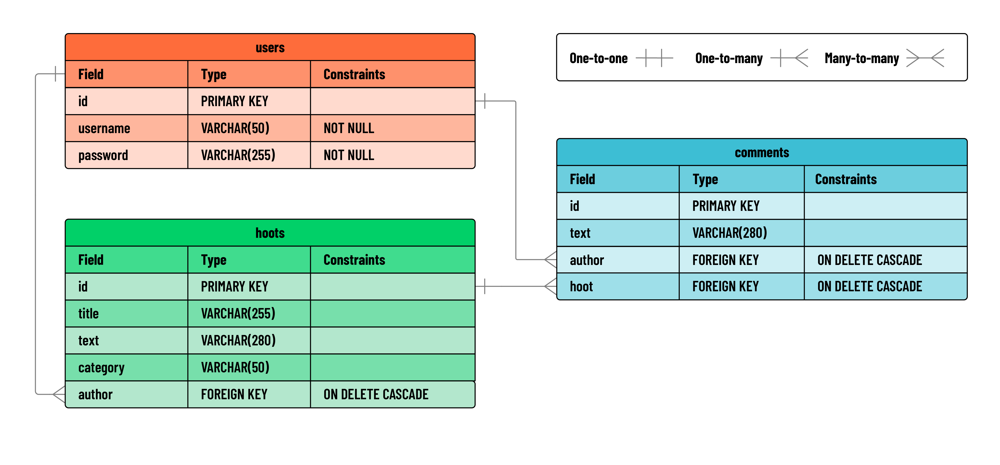

# 

**Learning objective:** By the end of this lesson, students will understand the architecture and functional requirements of building a secure Express API for a blogging application, including user authentication and CRUD operations for blog posts and comments.

## Overview

In this module, we'll build an API back-end for a full-stack blogging application called **Hoot** using Flask, PostgreSQL, and JWT authentication.

Within our Flask API, we'll implement full CRUD functionality on a blog post resource called `hoots`, as well as `create` functionality on a `comments` resource.

Our Flask API will make use of much of the code in the [Flask API JWT Auth Template](https://git.generalassemb.ly/modular-curriculum-all-courses/flask-jwt-auth-template.git), with a few caveats. 

To demonstrate the modularity of Flask, we'll be expanding upon the code found in the Flask API JWT Auth Template. To better understand these changes, we'll be pulling code snippets from the template, rather than cloning the template directly.

## User stories

Our Flask API will account for the following user stories:

- As a guest, I should be able to create an account.
- As a guest with an account, I should be able to log in to my account.
- AAU, I should be able to create a hoot post.
- AAU, I should be able to read a list of all hoots.
- AAU, I should be able to view information about a single hoot post along with its associated comments.
- AAU, I should be able to add a comment to a specific hoot.
- As the author of a hoot, I should be able to update that hoot.
- As the author of a hoot, I should be able to delete that hoot.

## Entity-relationship diagram

Take a look at the ERD below to get a sense of the data we'll be working with:



After reviewing the diagram above, consider some of the decisions that must be made when these particular data structures are applied to a relational database. For example, what should happen to child records when the parent is deleted? Should a user's posts be deleted along with the user, or should they remain? 

Different applications handle this differently, but for our application, we'll want to `CASCADE` the deletion of a user to include all their posts, and all comments associated with their posts. 

> 😎 No posts by `[deleted]` in our app!

## Flask & Postman

Below you can see a chart outlining the RESTful routes required for this application:

| HTTP Method | Controller | Response | URI | Use Case |
| ----------- | ------------- | -------- | ----------------------- | ----------------- |
| POST | `create_hoot` | 200 | `/hoots` | Create a hoot |
| GET | `hoots_index` | 200 | `/hoots` | List hoots |
| GET | `show_hoot` | 200 | `/hoots/<hoot_id>` | Get a single hoot |
| PUT | `update_hoot` | 200 | `/hoots/<hoot_id>` | Update a hoot |
| DELETE | `delete_hoot` | 200 | `/hoots/<hoot_id>` | Delete a hoot |
| POST | `create_comment` | 200 | `/hoots/<hoot_id>/comments` | Create a comment |

> 💡 When analyzing the RESTful routes in our application, think about what associated data might required for each query: the index page, for example, would certainly want the username of authors for each Hoot. JOINs will be very common in this app.

## SQL Queries

When using PostgreSQL, it can be helpful to give some thought to the necessary SQL queries before starting the application.

Below, you'll find the SQL queries that we'll use in our Flask app. If you wish, you can test these out in your `postgres` shell. Doing so can help isolate any problems with specific SQL before they are tied to application logic, and can make writing the routes much easier.

Review the sample queries below to get a better sense of what we'll implment in our application:

### Create hoot

```sql
INSERT INTO hoots (author, title, text, category) VALUES (2, 'testing hoot creation', 'of course the 2 would be a variable from the route', 'news') RETURNING *;
```

### Index hoots

```sql
SELECT h.id, h.author AS hoot_author_id, h.title, h.text, h.category, u_hoot.username AS author_username, c.id AS comment_id, c.text AS comment_text, u_comment.username AS comment_author_username 
FROM hoots h 
INNER JOIN users u_hoot ON h.author = u_hoot.id 
LEFT JOIN comments c ON h.id = c.hoot 
LEFT JOIN users u_comment ON c.author = u_comment.id;
```

> 💡 Notice the **aliasing** in this query to create a more readable response. Instead of `hoot.username`, which sounds like the username belongs to the hoot, we renamed that field to be accessible with `hoot.author_username` so the application can use a clearer property name. We also join the user table in multiple places, so we aliased those tables to `u_hoot` when joining with hoots and `u_comment` when joining with comments respectively.

### Show hoot

```sql
SELECT h.id, h.author AS hoot_author_id, h.title, h.text, h.category, u_hoot.username AS author_username, c.id AS comment_id, c.text AS comment_text, u_comment.username AS comment_author_username 
FROM hoots h 
INNER JOIN users u_hoot ON h.author = u_hoot.id 
LEFT JOIN comments c ON h.id = c.hoot 
LEFT JOIN users u_comment ON c.author = u_comment.id
WHERE h.id = 4;
```

> 💡 When testing this query, use any number for the id that exists in your database for now. If 4 doesn't exist, try something else!

### Update hoot

```sql
UPDATE hoots SET title = 'updated hoot!', text = 'updated text!', category = 'updated category!' WHERE hoots.id = 4 RETURNING *;
```

### Delete hoot

```sql
DELETE FROM hoots WHERE hoots.id = 4;
```

> 💡 Note, you may have needed to create more hoots to keep going after testing the delete hoot queries!

### Create comment

```sql
INSERT INTO comments (author, hoot, text) VALUES (2, 5, 'I believe this is the finest post that was ever written') RETURNING *;
```
