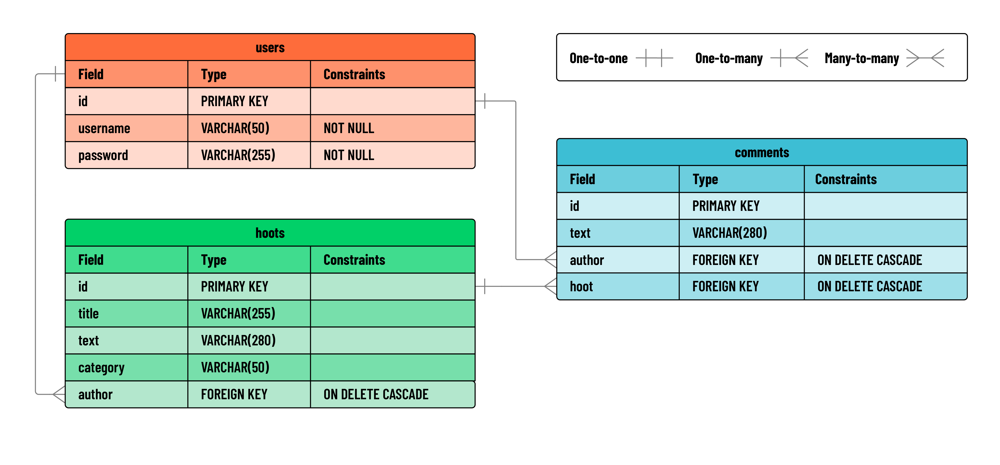

# 

**Learning objective:** By the end of this lesson, students will be able to tktk

## User stories

The social media application we're building, Hoot, has the basic functionality expected of most social sites. 

We'll be building functionality to support the following user stories:

- AAU, I should be able to create a blog post.
- AAU, I should be able to see a list of all blogs.
- AAU, I should be able to update one of my blogs.
- AAU, I should be able to delete one of my blogs.
- AAU, I should be able to comment on existing blogs.
- AAU, I should be able to view a single blog with its associated comments.

To support this functionality, Hoot has the following database structure (Note that, to avoid re-using the word "post" in confusing ways, we've renamed the basic blog post of the app to a "hoot"):



This means setting up some more SQL tables, this time with foreign keys!

This also means considering: what do we want to happen to child records when the parent is deleted: should a user's posts be deleted along with the user, or should they remain?

Different applications handle this differently, but for our application, we'll want to CASCADE the deletion of a user to include all their posts, and all comments associated with their posts. No posts by `[deleted]` in our app!

## Hoots table

Let's start by creating the hoots table and associating its author field with Users:

```SQL
CREATE TABLE hoots (
    id SERIAL PRIMARY KEY,
    author INTEGER REFERENCES users(id) ON DELETE CASCADE,
    title VARCHAR(255),
    text VARCHAR(280),
    category VARCHAR(50)
);
```

Assuming you've created a user with the id of `1` during your testing of the application, let's run some test queries to ensure things are hooked up:

```SQL
INSERT INTO hoots (author, title, text, category) VALUES ( 1, 'hello world', 'greetings to you all', 'news');
```

Now try inserting a hoot with a non-existant author:

```SQL
INSERT INTO hoots (author, title, text, category) VALUES ( 1066, 'Prepare for Glory', 'Harold Godwinson sends his regards', 'history');
```

The foreign key constraint should kick in and tell you that `Key (author)=(1066) is not present in table "users".` Excellent!

Let's test the association with a nice JOIN query to bring in usernames to our hoots:

```sql
SELECT * FROM hoots JOIN users ON hoots.author = users.id;
```

Looks great, but we don't really want our password hashes being sent with this query. Let's modify the SELECT section:

```SQL
SELECT hoots.*, users.username FROM hoots JOIN users ON hoots.author = users.id;
```

That's better! Let's also test out our CASCADE functionality by deleting user 1 and checking if their hoots still exist:

```SQL
DELETE FROM users WHERE users.id = 1;
SELECT * FROM hoots;
```

You should see 0 hoots remaining in the database, since their author was deleted.

## Comments table

Comments will work very similarly, so try taking a guess at the SQL statement required to create this table. Don't forget our CASCADE decision to delete comments whenever a hoot is deleted.

```sql
CREATE TABLE comments (
id SERIAL PRIMARY KEY,
author INTEGER REFERENCES users(id) ON DELETE CASCADE,
hoot INTEGER REFERENCES hoots(id) ON DELETE CASCADE,
text VARCHAR(280)
);
```

Try out some SQL queries testing the connections and cascading between them. 

Once you're convinced the SQL tables are set up properly, let's prepare the queries for our Flask app before creating all the routes.